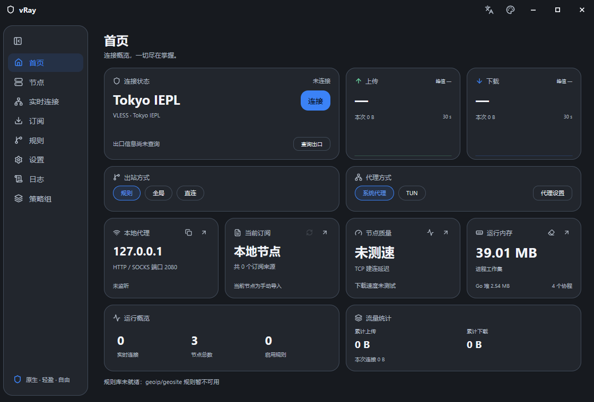
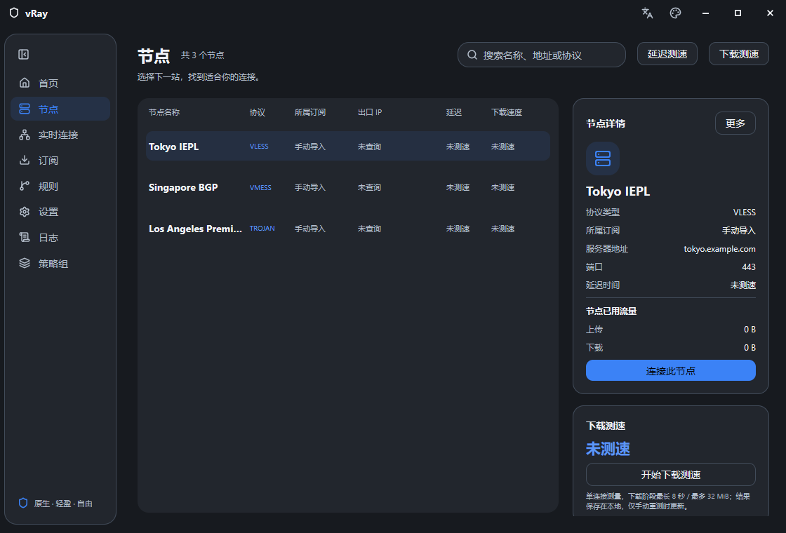

<p align="center">
  
</p>

<h1 align="center">vRay</h1>

<p align="center">
  原生、轻盈、自由。<br>
  基于 MyGO + CrychicUI 构建，并将 Xray-core 直接嵌入进程的桌面客户端。
</p>

<p align="center">
  <a href="https://github.com/sbgayhub/vray/actions/workflows/ci.yml"></a>
  
  
  
</p>

## 界面预览

<p align="center">
  <a href="docs/images/readme-home.png"></a>
  <a href="docs/images/readme-nodes.png"></a>
</p>

<p align="center">
  <sub>首页连接概览与实时状态 · 节点列表、延迟和出口信息</sub>
</p>

## 特性

- **单进程运行**：Xray-core 以内嵌 Go 库方式启动，无需额外内核文件、IPC 或本地管理进程。
- **原生桌面体验**：MyGO 原生窗口、自绘标题栏、系统托盘、深浅主题与多种窗口材质，没有 WebView 和前端构建链。
- **广泛的节点支持**：VLESS（含 REALITY、Vision）、VMess、Trojan、Shadowsocks、Hysteria2，以及 TCP、WebSocket、gRPC、HTTPUpgrade、XHTTP、mKCP 等传输方式。
- **订阅与策略组**：支持分享链接、Base64、Clash 订阅、定时更新，以及手动选择、最低延迟、故障转移和负载均衡策略。
- **可解释的路由**：规则、全局、直连三种出站方式，支持域名、IP、端口、进程与 Geo 规则，并按顺序匹配。
- **完整的运行观测**：实时上下行速率、历史曲线、活动连接、节点 TCP 延迟、下载测速、出口 IP、ASN 与流量统计。
- **日常桌面集成**：系统代理与 TUN、开机自启、关闭到托盘、三语言界面，以及带签名校验的应用更新。
- **本地优先**：节点、订阅、日志和凭据保存在本机；默认零遥测，诊断包不会包含数据库或凭据。

## 快速开始

### 使用发布包

从 [GitHub Releases](https://github.com/sbgayhub/vray/releases) 下载对应平台的安装包或便携包。Windows 使用 TUN 时，需要以管理员身份运行，并确保 `wintun.dll` 位于程序旁边。

首次启动会显示免责声明与使用协议。同意前，订阅更新、Geo 数据下载和更新检查都不会启动。

### 从源码运行

需要 Go 1.27.3 或更高版本：

```bash
git clone https://github.com/sbgayhub/vray.git
cd vray
go run .
```

生成平台安装包需要 MyGO CLI 0.7.1：

```bash
go install github.com/egoist/mygo/cmd/mygo@v0.7.1
mygo build -platform "windows/amd64"
```

其他平台可使用对应的 MyGO 目标，例如 `linux/amd64`、`darwin/arm64`。

## 数据目录

vRay 默认使用当前用户的标准数据目录：

| 平台 | 默认位置 |
|---|---|
| Windows | `%LOCALAPPDATA%\vRay` |
| macOS | `~/Library/Application Support/vRay` |
| Linux | `~/.config/vRay` |

可在设置页迁移数据目录，也可以通过环境变量临时覆盖：

```powershell
$env:VRAY_DATA = "D:\vRayData"
go run .
```

便携包可在可执行文件旁放置名为 `portable` 的空文件，数据将保存到程序旁的 `data` 目录。`VRAY_DATA` 的优先级最高。

## 运行要求

- Windows 10/11、macOS 或 Linux。
- 系统代理模式无需特权，适合大多数桌面应用。
- Windows 的 TUN 模式需要管理员权限与 `wintun.dll`。
- macOS/Linux 的 TUN 模式需要 root 权限，或由外部提供已授权的 `XRAY_TUN_FD`。
- Geo 规则依赖 `geoip.dat` 与 `geosite.dat`；首次启动同意条款后会在后台下载，下载完成前普通规则仍可使用。

## 开发

```bash
# 单元测试
go test ./...

# 竞态检查
go test -race ./...

# 静态检查
go vet ./...
```

主要代码结构：

| 目录 | 职责 |
|---|---|
| `internal/app` | 应用状态、订阅、规则、策略组、连接与更新 |
| `internal/core` | Xray 生命周期、配置生成、统计、日志和系统副作用 |
| `internal/ui` | 原生页面、对话框、主题与本地化界面 |
| `internal/store` | 本地 JSON 数据与版本迁移 |
| `docs` | 产品规划、详细设计、实现计划与实作笔记 |


## 安全与隐私

- vRay 不内置代理服务器、节点或订阅内容，也不附带遥测或商业导流。
- 节点凭据存放于系统凭据存储；日志与诊断信息会经过脱敏处理。
- 出口 IP 查询会访问 `ipapi.is`，失败时回退到 `ipwho.is`。Geo 数据来自 GitHub 上的 `Loyalsoldier/v2ray-rules-dat`，应用更新会访问 GitHub Releases。
- 系统代理和 TUN 会改变应用或系统的网络路径。vRay 会记录已修改的系统设置，并在正常退出或下次启动时尝试恢复。

## 免责声明

vRay 仅提供本地客户端能力，不提供任何网络服务。使用者需要自行确认节点来源、配置和用途合法可靠，并遵守所在国家或地区的法律法规、网络服务商条款及目标服务的使用规则。软件按现状提供，使用风险由使用者自行承担；完整条款见应用内“免责声明与使用协议”。

## 第三方组件

vRay 内嵌 Xray-core，并使用 MyGO 与 CrychicUI 构建原生界面，Xray-core 使用 MPL-2.0，Wintun 使用 MIT 许可证。
